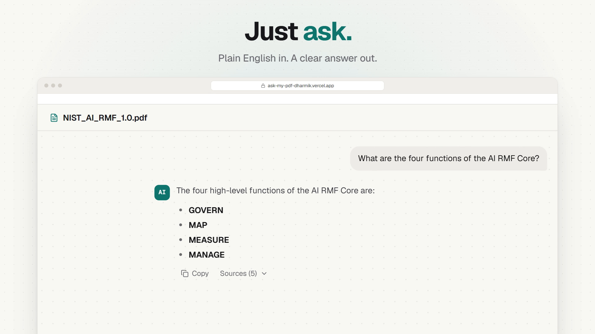
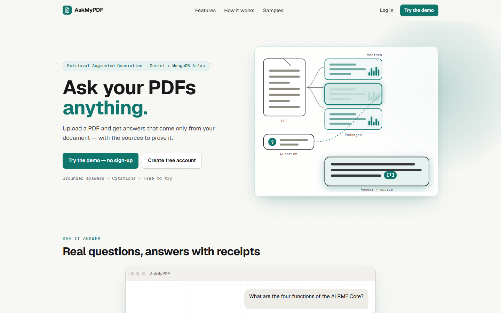
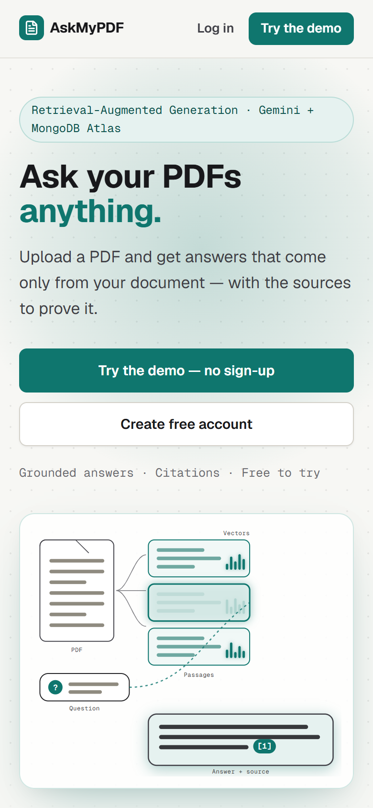
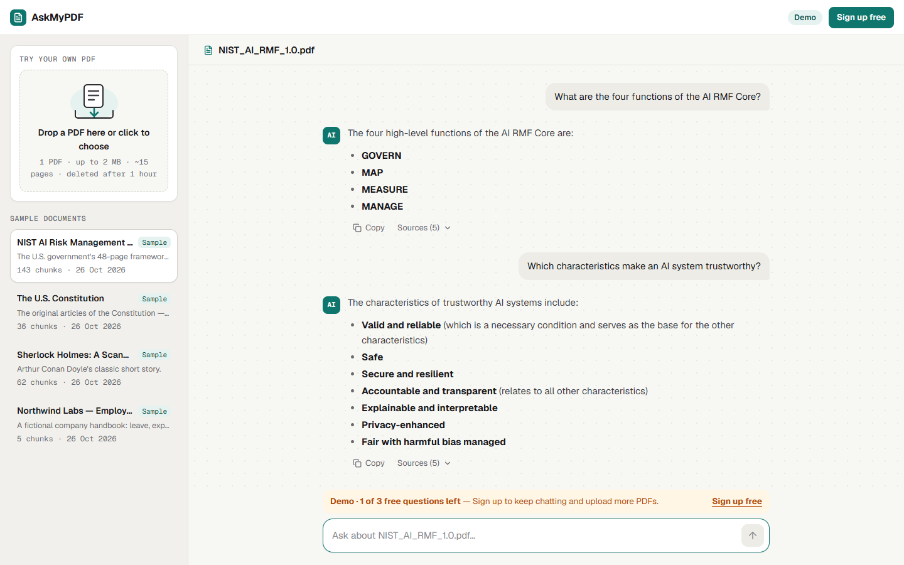
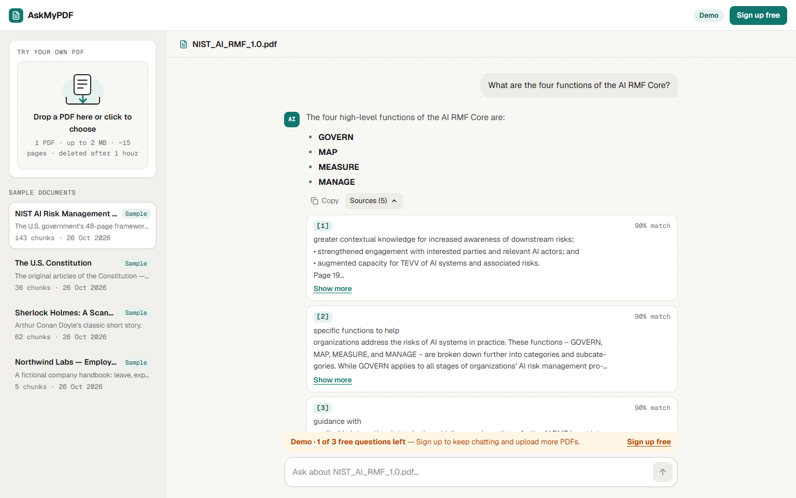
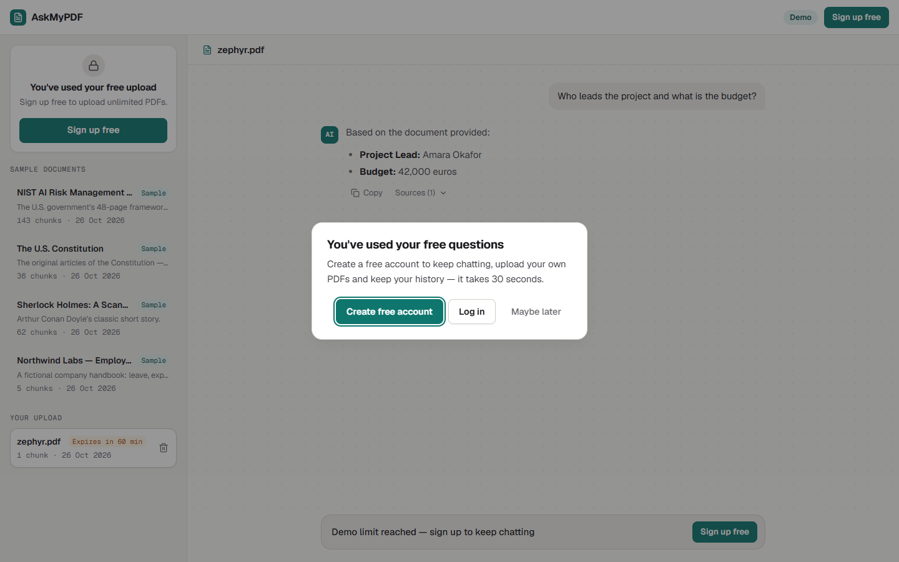
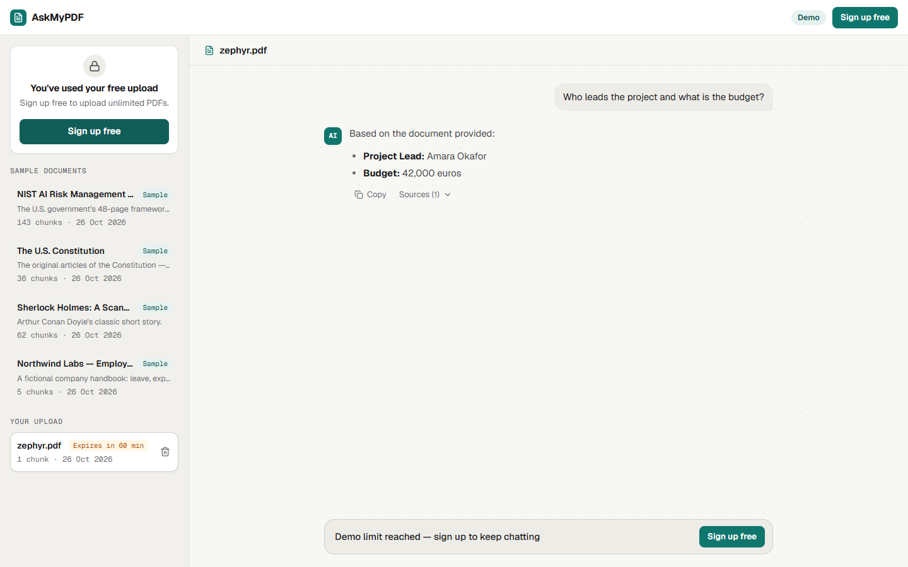
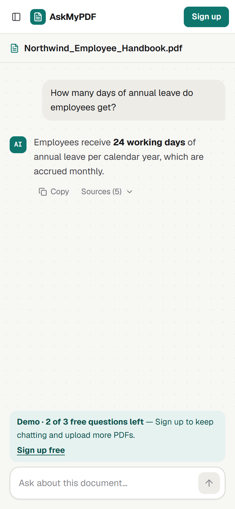

# AskMyPDF — Frontend

Chat with your PDFs: ask questions in plain language and get answers that come only from your document, with the source passages to prove it.

**Live demo:** https://ask-my-pdf-dharmik.vercel.app

## Watch the walkthrough (84 s)

[](docs/video/askmypdf-walkthrough.mp4)

## Try the demo

Click **Try the demo — no sign-up** on the landing page. You get a guest session with:

- **4 sample documents** to explore: the NIST AI Risk Management Framework, the U.S. Constitution, a Sherlock Holmes story and a fictional employee handbook.
- **3 free questions** across the samples.
- **1 upload of your own PDF** (up to 2 MB, about 15 pages), deleted automatically after 1 hour.

Sign up for a free account to remove these limits (uploads up to 10 MB, saved chat history).

## Features

- Grounded answers with expandable, numbered **citations** and match scores
- **Follow-up questions** that remember context, per document
- **Drag-and-drop upload** with live progress and clear error messages
- Markdown answers (lists, tables, code), one-click copy
- Animated landing page explaining the RAG pipeline
- Cold-start banner for the free-tier backend
- Responsive and keyboard-accessible, with an off-canvas document drawer on mobile

## How it works

1. **Upload** — text is extracted from the PDF and split into overlapping passages.
2. **Index** — each passage becomes a Gemini embedding stored in MongoDB Atlas Vector Search.
3. **Ask** — your question finds the closest passages and Gemini answers only from them, with citations.

The server side, including its architecture diagram, lives in the backend repo: https://github.com/dharmikpuri/AskMyPDF_Backend

## Tech stack

React 19 · Vite 8 (React Compiler) · React Router 7 · Axios · react-markdown + remark-gfm · lucide-react · react-toastify. Plain JSX and hand-written CSS with "Paper & Jade" design tokens (`src/index.css`).

## Local setup

```bash
npm install
# create a .env file containing: VITE_API_URL=<backend url, e.g. http://localhost:5000>
npm run dev
```

| Script | What it does |
| --- | --- |
| `npm run dev` | Start the Vite dev server |
| `npm run build` | Production build to `dist/` |
| `npm run preview` | Preview the production build |
| `npm run lint` | Run ESLint |

## Deployment

Deployed on Vercel as a static site; `vercel.json` rewrites every route to `index.html` so client-side routing works on refresh.

1. Set `VITE_API_URL` to the backend URL in the Vercel project settings.
2. Build command: `npm run build` (`vite build`), output directory: `dist`.

## Screenshots







